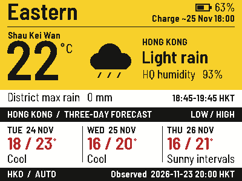
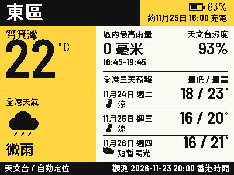
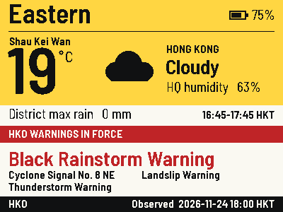
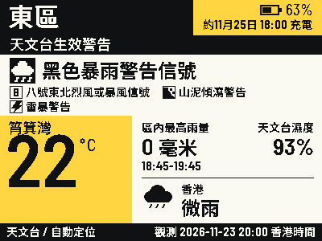
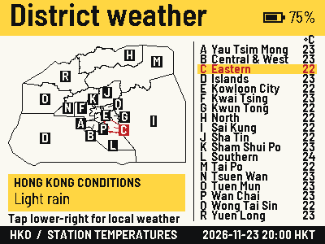
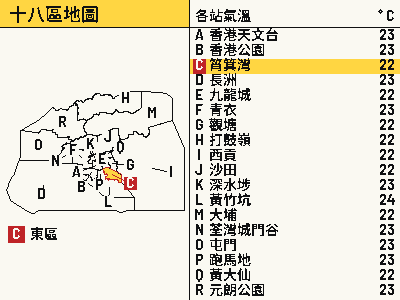
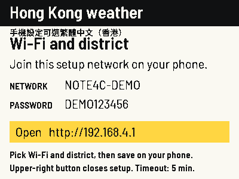
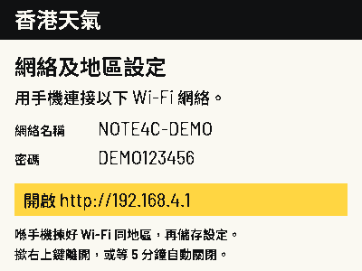
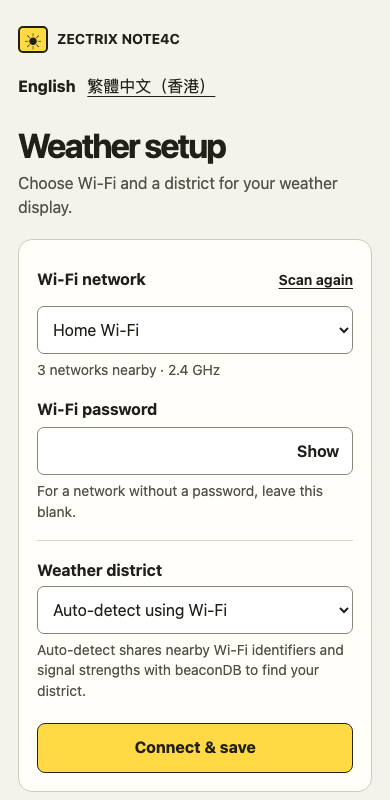
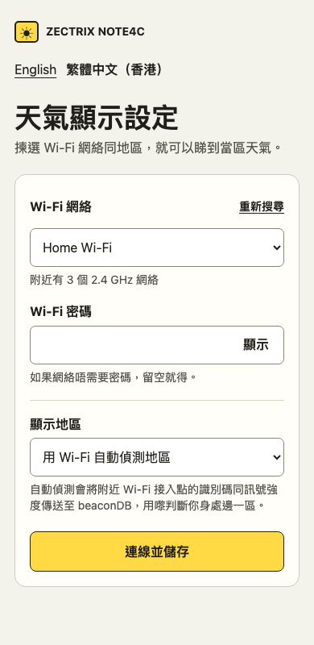

# Hong Kong Weather for the ZECTRIX NOTE4C

A third-party Hong Kong Observatory weather dashboard for the **ZECTRIX NOTE4C Dev Kit, PCB v1.0**. It shows a representative station temperature for any of Hong Kong’s 18 districts, the district’s maximum recorded rainfall and a territory-wide three-day forecast. The target is the ESP32-S3 N16R8 with the 400 × 300 four-colour e-paper panel. [NOTE4C hardware guide](https://wiki.zectrix.com/en/hardware/note4c/quick-start)

| Version | What you can use |
| --- | --- |
| **Bilingual release · v1.0.0** | English and 繁體中文（香港）, 15-minute weather and warning checks, and an 18-district station map. [Download the NOTE4C firmware](https://github.com/jkws1994/zectrix-note4c-hk-weather-third-party/releases/download/v1.0.0/NOTE4C-HK-Weather.bin) · [Source and checksums](https://github.com/jkws1994/zectrix-note4c-hk-weather-third-party/releases/tag/v1.0.0) |
| **Earlier English beta · v0.1.0-beta.1** | English dashboard with hourly weather checks. [Earlier release and instructions](https://github.com/jkws1994/zectrix-note4c-hk-weather-third-party/releases/tag/v0.1.0-beta.1) |

## Install the bilingual firmware

Use the merged `NOTE4C-HK-Weather.bin` for the four-colour NOTE4C Dev Kit, PCB v1.0. Back up the full 16 MB flash first, then follow the NOTE4C updater instructions with a USB data cable and the merged image at **0x0000**. Keep the backup private because it may contain saved Wi-Fi credentials. [NOTE4C hardware and backup guide](https://wiki.zectrix.com/en/hardware/note4c/quick-start) · [ZECTRIX firmware updater](https://www.zectrix.com/en/firmware-updater.html)

下載雙語韌體後，先備份裝置，再經 USB 刷寫。首次開機時，用手機連接螢幕顯示嘅 Wi-Fi 熱點，再開啟 `http://192.168.4.1`，揀 **繁體中文（香港）** 並儲存設定。[雙語韌體下載](https://github.com/jkws1994/zectrix-note4c-hk-weather-third-party/releases/download/v1.0.0/NOTE4C-HK-Weather.bin)

For a local build, open the source folder containing `platformio.ini` and run `pio run -e note4c`. To verify the downloadable firmware and source archive on macOS, place both files and `SHA256SUMS.txt` in one folder and run `shasum -a 256 -c SHA256SUMS.txt`. [Source archive](https://github.com/jkws1994/zectrix-note4c-hk-weather-third-party/releases/download/v1.0.0/HKWeather-source.zip) · [SHA-256 checksums](https://github.com/jkws1994/zectrix-note4c-hk-weather-third-party/releases/download/v1.0.0/SHA256SUMS.txt)

## Bilingual build previews

The e-paper images come from the firmware’s 400 × 300 display buffer. The phone images show the setup form with example network details. The warning screens simulate a **Black Rainstorm Warning** alongside a No. 8 Northeast signal, a Landslip Warning and a Thunderstorm Warning. For warnings currently in force, check the Observatory. [Current HKO warnings](https://www.hko.gov.hk/en/wxinfo/dailywx/wxwarntoday.htm)

| Screen | English | 繁體中文（香港） |
| --- | --- | --- |
| Local weather |  |  |
| Active warnings · simulated |  |  |
| District map |  |  |
| Setup on the NOTE4C |  |  |
| Setup on the phone |  |  |

## 手機設定同實體按鍵

雙語版首次開機會顯示設定熱點。已經設定過嘅話，等裝置休眠，再長撳右下鍵約兩秒，就可以重新開啟設定。

1. 用手機連接螢幕顯示嘅 **NOTE4C-…** 熱點，輸入螢幕上嘅密碼，再用瀏覽器開啟 `http://192.168.4.1`。
2. 撳頁頂嘅 **繁體中文（香港）**。喺清單揀一個 2.4 GHz Wi-Fi 網絡，或者揀 **沿用已儲存的 Wi-Fi**。如果搵唔到自己個網絡，可以撳 **重新搜尋**。
3. 揀你想睇嘅地區，或者揀 **用 Wi-Fi 自動偵測地區**。撳 **連線並儲存** 或 **儲存設定**。裝置會記住你揀嘅語言，下次開機都會用返。
4. 休眠時短撳右下鍵，可以喺本區天氣同十八區地圖之間切換。想睇警告詳情，就返去本區天氣頁。想即時查一次天氣同警告，就喺休眠時撳正面圓鍵。

## Phone setup and buttons

Join the Wi-Fi hotspot shown on the panel and open `http://192.168.4.1`. Choose **English** or **繁體中文（香港）** at the top. Select a visible 2.4 GHz network from the scan list or keep your saved Wi-Fi. Choose a district or opt into automatic detection, then save. Changing languages in the browser preserves the selected district and the password already entered for a network that is still listed. Saving also applies the language to the e-paper display and future setup sessions.

| Button | Action in the bilingual build |
| --- | --- |
| Front circular button | Tap while asleep to check weather, warnings and battery. |
| Lower-right button | Tap while asleep to switch between the local dashboard and the map. Hold for about two seconds to open phone setup. |
| Upper-right button | Tap during setup to discard unsaved edits and close the hotspot. Holding it during reset also opens setup. |

Setup closes after five minutes. If the display says **SET CLOCK IN SETUP** or **請到設定校時**, open setup from a phone showing the correct time, keep the saved Wi-Fi and save again. With JavaScript enabled, the board can use the phone’s clock when its own time is unset. It also tries network time and can restore time from the onboard RTC after a successful sync.

## Reading the two e-paper pages

**Local dashboard.** The large number is the temperature at the named station. Rainfall is the district maximum over the interval shown. Humidity comes from Observatory Headquarters. Conditions and the three-day low/high forecast cover Hong Kong. The footer gives the observation time in HKT. Dashes mark missing readings.

**Warnings.** On the local dashboard, active signals replace the forecast. Up to five appear with icons and names, and a count covers any additional signals. Amber, Red and Black Rainstorm use yellow, red and black tiles respectively. No. 8 signals retain the wind direction. A successful check uses a solid heading. If a check fails, an outlined heading identifies cached warnings, or an unavailable message appears if there are none in memory. [HKO warning symbols in English](https://www.hko.gov.hk/en/wxinfo/dailywx/warnlegend.htm) · [天文台警告圖示及名稱](https://www.hko.gov.hk/tc/wxinfo/dailywx/warnlegend.htm)

**District map.** Match the letters A–R on the left to the 18 representative HKO station temperatures on the right. The selected district has a highlighted boundary and station row. Temperatures are rounded to whole degrees Celsius. If the readings are stale or an update fails, the map shows the status and the last observation time when available. Warning details and the battery indicator are on the local dashboard. [District boundaries](https://data.gov.hk/en-data/dataset/hk-had-json1-hong-kong-administrative-boundaries)

**Battery.** The icon shows an estimated percentage. At 20% or below, the unplugged board shows a charge reminder. After at least six hours of readings and a drop of five percentage points, it can estimate when the battery will reach 20%. The time shown is in HKT and rounded up to the hour. Connecting the charger restarts the estimate.

## Refresh schedule

| Bilingual build check | Hong Kong time |
| --- | --- |
| Current weather, HKO warning summary and battery | Every 15 minutes, at 05, 20, 35 and 50 minutes past the hour |
| Forecast used for the three-day display | Scheduled checks at 11:35 and 16:35, plus manual refreshes and retries |
| Network time | When the clock is unset and at the first connected check at least six hours after a successful network sync |

HKO lists the current weather report as hourly with additional updates, the nine-day forecast as twice daily with additional updates, and the warning summary as updated when warnings change. A new warning can therefore appear between device checks. The observation timestamp can stay the same across several wakes. After each check the board returns to deep sleep and skips the panel refresh if the image is unchanged. [HKO dataset update frequencies](https://www.hko.gov.hk/en/abouthko/opendata_intro.htm)

## District detection and privacy

Choosing a named district keeps district selection on the board. **Auto-detect** sends up to 12 eligible nearby Wi-Fi access point identifiers and their signal strengths to beaconDB over HTTPS. The board checks whether the returned location and its uncertainty fit within one district. If a new fix fails, it labels the last confirmed district or shows the Hong Kong overview. Setup credentials stay in device storage. A full flash backup made after setup can contain them. The weather dashboard uses HKO public data and requires no OpenAI or weather API key. [beaconDB privacy notice](https://beacondb.net/privacy/) · [HKO open data](https://www.hko.gov.hk/en/abouthko/opendata_intro.htm)

## Verification

The bilingual build was cross-compiled for ESP32-S3. Host tests exercised all 18 stations, the warning labels, cached warnings, language and settings recovery, and 96 scheduled checks over a simulated day. Browser tests covered language switching, Wi-Fi rescanning and retaining a selection. Physical panel refresh, button wake and battery operation still need verification on a NOTE4C. In dense scans, automatic district detection can overlook access points beyond the first 256. A named district can be selected in setup.
